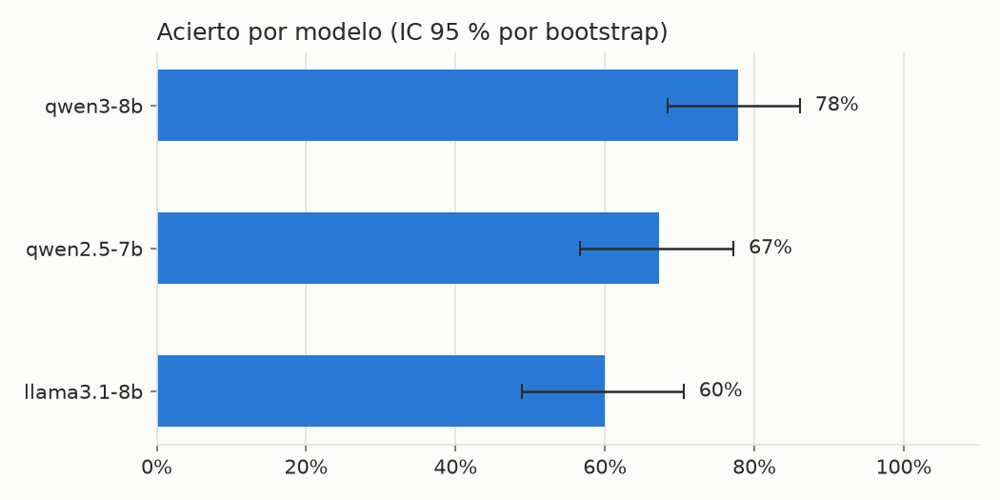

# llm-bench-es

Benchmark reproducible para comparar modelos de lenguaje abiertos en preguntas técnicas en español, con foco en ciberseguridad e ingeniería informática. Los modelos se ejecutan en local con [Ollama](https://ollama.com).

> **Estado:** primera fase completada (comparación de modelos con 60 preguntas de opción múltiple). El estudio de la cuantización y la revisión humana del conjunto de preguntas están pendientes.

## Preguntas de investigación

1. ¿Qué modelo abierto de tamaño mediano (7-8B) responde mejor preguntas técnicas en español?
2. ¿Cuánta precisión se pierde al cuantizar (4, 8 y 16 bits) y compensa el ahorro de memoria? *(pendiente)*

## Resultados

60 preguntas de opción múltiple, 3 repeticiones por modelo y 540 respuestas en total. Todos los modelos usan la cuantización Q4_K_M. Informe completo: [`reports/summary_results_60preguntas_revisadas.md`](reports/summary_results_60preguntas_revisadas.md).

| modelo | acierto | IC 95 % | consistencia entre repeticiones | tokens/s (mediana) |
|---|---|---|---|---|
| qwen3-8b (`think: false`) | **78 %** | 68 – 86 % | 78 % | 12,5 |
| qwen2.5-7b | 67 % | 57 – 77 % | 63 % | 14,8 |
| llama3.1-8b | 60 % | 49 – 71 % | 63 % | 9,9 |



**Qué se observa:**

- **qwen3-8b es el mejor**, aunque su intervalo se solapa con el de qwen2.5-7b. Con 60 preguntas, una diferencia de unos 10 puntos no basta para afirmar que uno es mejor que otro.
- **La dificultad es lo que más pesa.** Las preguntas fáciles se aciertan casi siempre (98-100 %) y las difíciles muy poco (25-42 %). Los fallos se concentran en cálculos de varios pasos, como RSA, semáforos o tiempos de transmisión.
- **Los modelos no siempre saben la respuesta, a veces la adivinan.** Como el orden de las opciones se baraja en cada repetición, un modelo que conoce la respuesta debería elegir siempre la misma opción. Solo lo hace entre el 63 % y el 78 % de las veces.
- **Sesgo de posición.** En una versión anterior del conjunto la respuesta correcta nunca era la A, y los modelos Qwen elegían la A de más. Tras equilibrar las letras (15 de cada una) y barajar las opciones, el sesgo casi desaparece. llama3.1 sigue eligiendo la B más de la cuenta (36 % de sus respuestas).

| acierto por dificultad | llama3.1-8b | qwen2.5-7b | qwen3-8b |
|---|---|---|---|
| fácil | 98 % | 100 % | 100 % |
| media | 61 % | 70 % | 87 % |
| difícil | 25 % | 33 % | 42 % |

## Metodología

- **Conjunto de evaluación:** 60 preguntas propias de opción múltiple con 4 opciones, sobre redes, criptografía, sistemas operativos, programación, bases de datos y seguridad. La letra correcta está equilibrada (15 A, 15 B, 15 C, 15 D). Se describen en [`data/README.md`](data/README.md) y en la [guía de anotación](docs/annotation_guide.md).
- **Protocolo:** temperatura 0, el mismo prompt ([`prompts/es_v1.txt`](prompts/es_v1.txt)), contexto de 4096 tokens y respuesta limitada a una letra. Toda la configuración está en [`configs/default.yaml`](configs/default.yaml).
- **Repeticiones:** con temperatura 0, repetir el mismo prompt da la misma respuesta. Por eso en cada repetición se barajan las opciones con una semilla fija. Así se mide si el modelo conoce la respuesta o elige una posición.
- **Estadística:** intervalos de confianza del 95 % por *bootstrap* (1000 remuestreos). Se remuestrean **preguntas**, no respuestas, porque las repeticiones de una misma pregunta no son independientes.
- **Eficiencia:** tokens por segundo y latencia por respuesta, a partir de las métricas que devuelve Ollama.

## Limitaciones

- **Conjunto pequeño.** Con 60 preguntas los intervalos de confianza miden unos ±10 puntos.
- **Preguntas sin revisión humana completa.** Las preguntas son un borrador (campo `annotator`). Se hizo una revisión que corrigió 10 de ellas, pero todavía falta una revisión independiente.
- **Solo opción múltiple.** No se evalúan respuestas abiertas ni razonamiento explícito, porque el prompt pide contestar solo con la letra.
- **Hardware.** Las ejecuciones se hicieron en un portátil sin GPU dedicada, así que las cifras de velocidad son de inferencia en CPU y dependen de ese equipo (ver [Entorno de ejecución](#entorno-de-ejecución)).
- **Posible contaminación.** Muchos temas son comunes en la web y pueden aparecer en los datos de entrenamiento de los modelos.

## Entorno de ejecución

| componente | detalle |
|---|---|
| CPU | Intel Core i7-13620H (10 núcleos, 16 hilos) |
| GPU | Intel UHD Graphics (integrada; Ollama no la usa) |
| RAM | 16 GB |
| Sistema | Windows 11 |
| Inferencia | Ollama, 100 % en CPU, modelos en Q4_K_M |

## Reproducir los experimentos

Requisitos: Python 3.11+, [uv](https://docs.astral.sh/uv/) y Ollama en ejecución.

```bash
# 1. Crear el entorno
uv sync --extra dev

# 2. Descargar los modelos
ollama pull qwen2.5:7b
ollama pull qwen3:8b
ollama pull llama3.1:8b

# 3. Ejecutar la evaluación (unos 45 minutos en un portátil)
uv run python -m llm_bench.run --config configs/default.yaml --output reports/results.csv

# 4. Generar el informe y las gráficas
uv run python -m llm_bench.report --results reports/results.csv --config configs/default.yaml
```

Si la ejecución se corta, se continúa donde se quedó añadiendo `--resume`. Cada respuesta se guarda en el CSV en cuanto llega, y si Ollama falla se reintenta automáticamente.

Para pasar las pruebas:

```bash
uv run pytest
uv run ruff check .
```

Los pesos de los modelos no se incluyen en el repositorio. Cada uno se descarga desde su fuente oficial.

## Estructura

```
llm-bench-es/
├── configs/          # configuración de modelos y experimentos
├── data/             # conjunto de preguntas y su esquema
├── docs/             # guía de anotación
├── prompts/          # plantillas de prompt
├── reports/          # resultados (CSV), informes y gráficas
├── src/llm_bench/    # cliente de Ollama, ejecución, puntuación e informe
├── tests/            # pruebas del esquema, la puntuación, la ejecución y el informe
├── pyproject.toml
└── README.md
```

## Próximos pasos

- Estudio de la cuantización (Q4, Q8 y F16 del mismo modelo).
- Ampliar el conjunto a 150-200 preguntas y completar su revisión humana.
- Un prompt que permita razonar antes de responder, para ver si mejoran las preguntas de cálculo.

## Licencia

El código está bajo licencia [MIT](LICENSE). La licencia del conjunto de preguntas se indica en [`data/README.md`](data/README.md).
