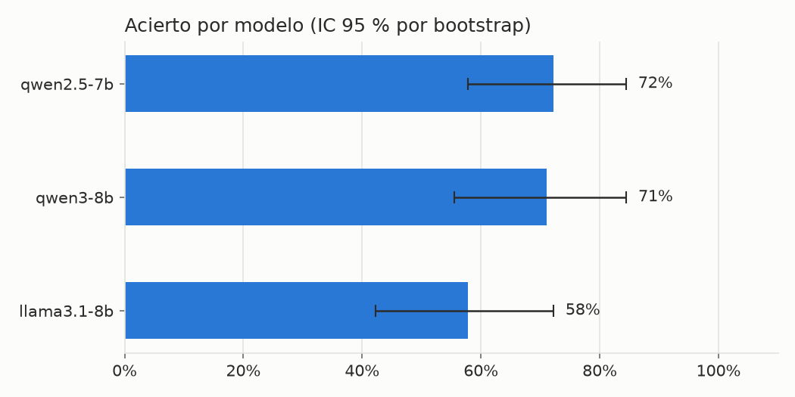
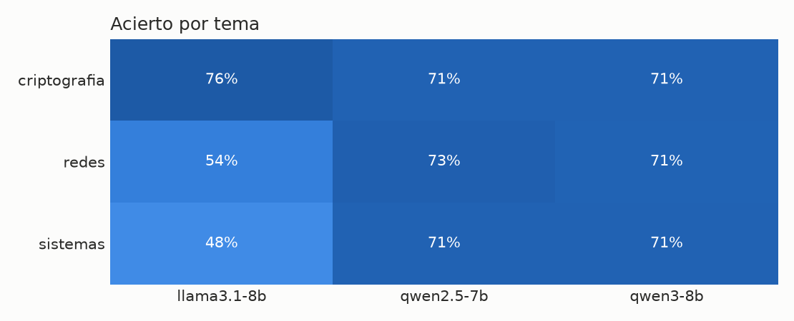
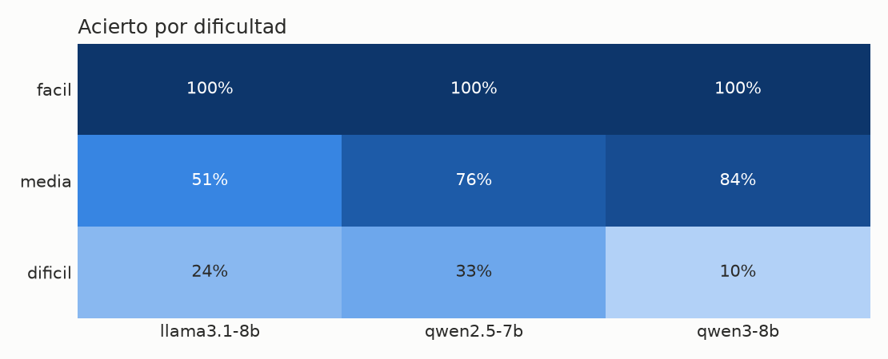
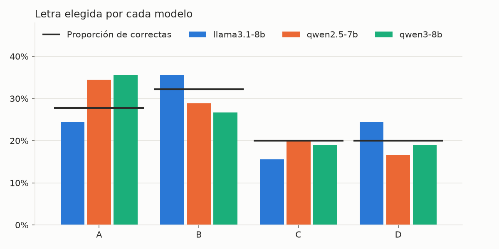

# Resumen de `reports/results_30preguntas.csv`

Generado con `python -m llm_bench.report`. No edites este fichero a mano.

Preguntas: 30 · Modelos: 3 · Repeticiones: 3 · Remuestreos bootstrap: 1000

## Acierto por modelo

| modelo | acierto | IC 95 % | preguntas | repeticiones | no interpretables |
|---|---|---|---|---|---|
| qwen2.5-7b | 72% | 58% - 84% | 30 | 3 | 0 |
| qwen3-8b | 71% | 56% - 84% | 30 | 3 | 0 |
| llama3.1-8b | 58% | 42% - 72% | 30 | 3 | 0 |

## Acierto por tema

| tema | llama3.1-8b | qwen2.5-7b | qwen3-8b |
|---|---|---|---|
| criptografia | 76% | 71% | 71% |
| redes | 54% | 73% | 71% |
| sistemas | 48% | 71% | 71% |

## Acierto por dificultad

| dificultad | llama3.1-8b | qwen2.5-7b | qwen3-8b |
|---|---|---|---|
| facil | 100% | 100% | 100% |
| media | 51% | 76% | 84% |
| dificil | 24% | 33% | 10% |

## Sesgo de posición

Proporción de respuestas que van a cada letra. La fila `(correctas)` indica con qué frecuencia cada letra es la correcta.

| modelo | A | B | C | D |
|---|---|---|---|---|
| llama3.1-8b | 24% | 36% | 16% | 24% |
| qwen2.5-7b | 34% | 29% | 20% | 17% |
| qwen3-8b | 36% | 27% | 19% | 19% |
| (correctas) | 28% | 32% | 20% | 20% |

## Consistencia entre repeticiones

| modelo | misma opción en todas las repeticiones |
|---|---|
| llama3.1-8b | 57% |
| qwen2.5-7b | 67% |
| qwen3-8b | 70% |

## Preguntas más falladas

Acierto medio de todos los modelos por debajo del 50 %. Conviene revisar que la clave y el enunciado sean correctos.

| pregunta | acierto medio |
|---|---|
| criptografia-0006 | 0% |
| criptografia-0007 | 11% |
| redes-0013 | 11% |
| redes-0015 | 22% |
| sistemas-0006 | 22% |
| redes-0016 | 22% |
| redes-0009 | 33% |
| redes-0014 | 33% |
| redes-0010 | 33% |
| sistemas-0003 | 44% |
| sistemas-0007 | 44% |
