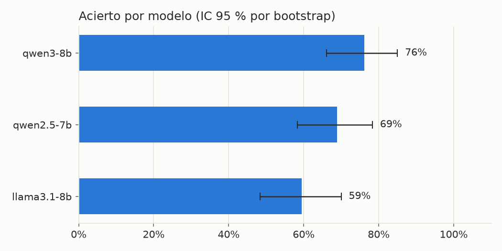
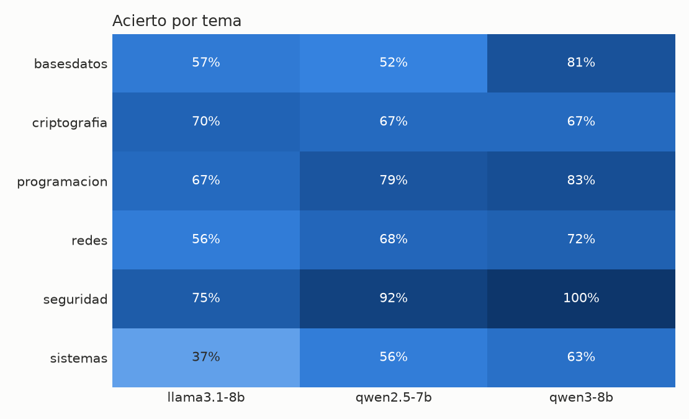
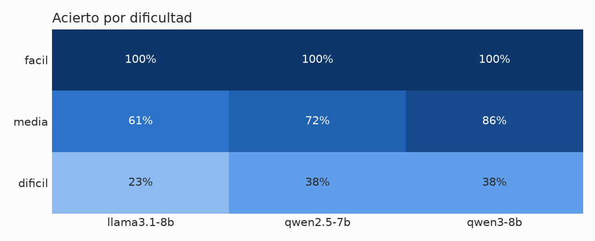
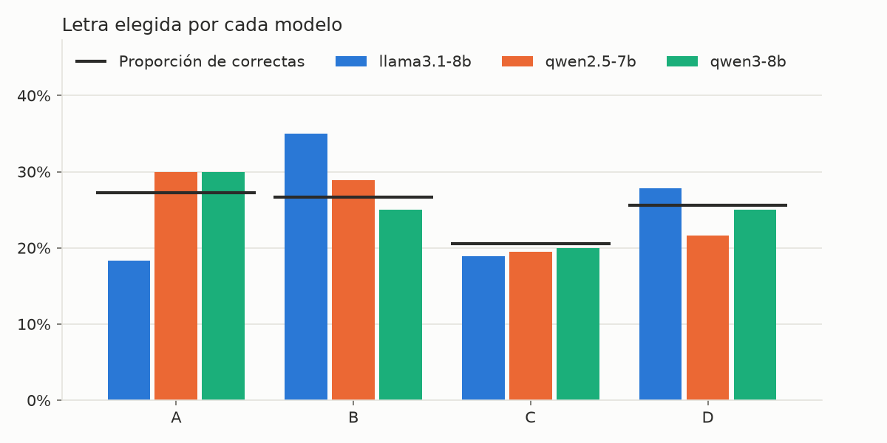

# Resumen de `reports/results_60preguntas.csv`

Generado con `python -m llm_bench.report`. No edites este fichero a mano.

Preguntas: 60 · Modelos: 3 · Repeticiones: 3 · Remuestreos bootstrap: 1000

## Acierto por modelo

| modelo | acierto | IC 95 % | preguntas | repeticiones | no interpretables |
|---|---|---|---|---|---|
| qwen3-8b | 76% | 66% - 85% | 60 | 3 | 0 |
| qwen2.5-7b | 69% | 58% - 78% | 60 | 3 | 0 |
| llama3.1-8b | 59% | 48% - 70% | 60 | 3 | 0 |

## Acierto por tema

| tema | llama3.1-8b | qwen2.5-7b | qwen3-8b |
|---|---|---|---|
| basesdatos | 57% | 52% | 81% |
| criptografia | 70% | 67% | 67% |
| programacion | 67% | 79% | 83% |
| redes | 56% | 68% | 72% |
| seguridad | 75% | 92% | 100% |
| sistemas | 37% | 56% | 63% |

## Acierto por dificultad

| dificultad | llama3.1-8b | qwen2.5-7b | qwen3-8b |
|---|---|---|---|
| facil | 100% | 100% | 100% |
| media | 61% | 72% | 86% |
| dificil | 23% | 38% | 38% |

## Sesgo de posición

Proporción de respuestas que van a cada letra. La fila `(correctas)` indica con qué frecuencia cada letra es la correcta.

| modelo | A | B | C | D |
|---|---|---|---|---|
| llama3.1-8b | 18% | 35% | 19% | 28% |
| qwen2.5-7b | 30% | 29% | 19% | 22% |
| qwen3-8b | 30% | 25% | 20% | 25% |
| (correctas) | 27% | 27% | 21% | 26% |

## Consistencia entre repeticiones

| modelo | misma opción en todas las repeticiones |
|---|---|
| llama3.1-8b | 63% |
| qwen2.5-7b | 68% |
| qwen3-8b | 77% |

## Preguntas más falladas

Acierto medio de todos los modelos por debajo del 50 %. Conviene revisar que la clave y el enunciado sean correctos.

| pregunta | acierto medio |
|---|---|
| basesdatos-0007 | 0% |
| criptografia-0009 | 0% |
| criptografia-0006 | 0% |
| sistemas-0008 | 0% |
| redes-0013 | 11% |
| criptografia-0007 | 11% |
| basesdatos-0004 | 22% |
| programacion-0002 | 22% |
| redes-0015 | 22% |
| redes-0016 | 22% |
| sistemas-0009 | 22% |
| sistemas-0006 | 22% |
| programacion-0007 | 22% |
| redes-0010 | 33% |
| redes-0009 | 33% |
| redes-0019 | 33% |
| sistemas-0007 | 44% |
| sistemas-0003 | 44% |
| redes-0014 | 44% |
| redes-0018 | 44% |
| seguridad-0007 | 44% |
